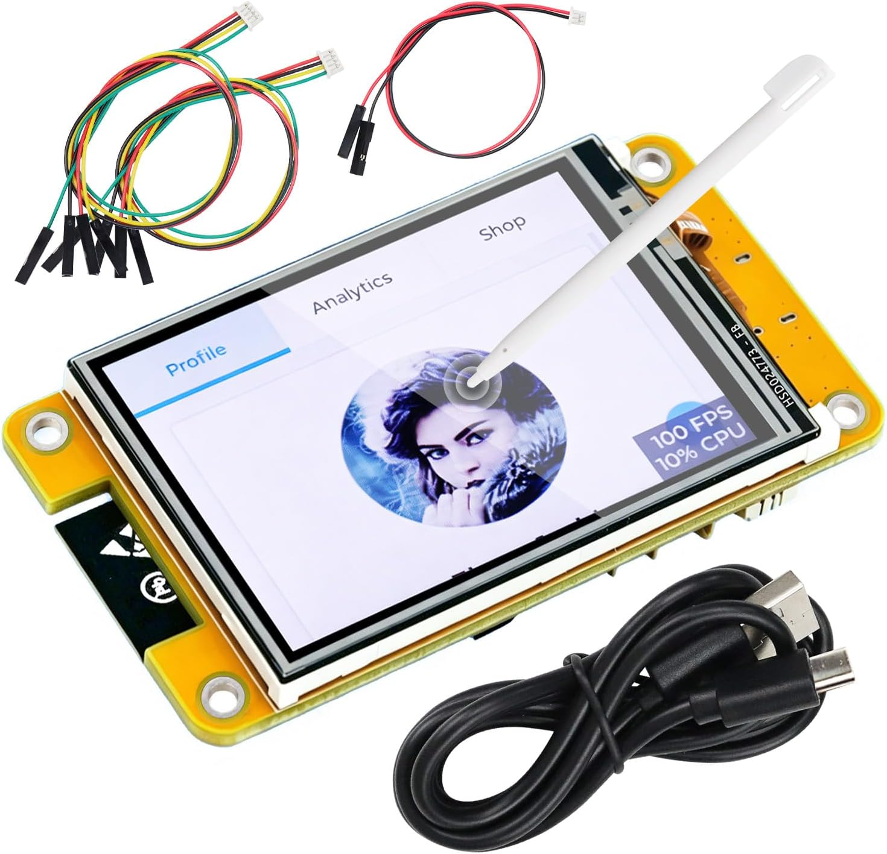

# The EchoDesk Project

**ESP-32 and CYD based operating system and utility management**

EchoDesk OS is a free, open-source touchscreen interface designed for the **Freenove FNK0114A 2.4-inch ESP32 display**.
Transform an inexpensive CYD (Cheap Yellow DIsplay) into a compact desktop monitor.


Built for makers, developers and anyone who wants a little more information on their desk.



## Utilities

### Home Dashboard

The launcher to launch applications and utilities.

- **Codex Usage** — Monitor your OpenAI Codex limits. Support for Claude Code and Gemini coming soon.
- **Clock** — A bold, minimal clock with customisability.
- **Performance** — Live CPU, GPU, memory, network and temperature graphs from the Windows host.
- **Now Playing** — Live Windows media metadata, artwork, progress and supported transport controls.
- **Settings** — Adjust brightness and restart the device, with more settings coming soon.

### Codex Usage Monitor

View your Codex usage directly on your desk without opening a browser.

Support for:
- 5-hour session usage
- Weekly usage
- Usage percentages and progress bars
- Reset countdowns
- Live updates through the Windows companion application

EchoDesk builds on the open-source AI Monitor project. EchoDesk Desktop manages
the bundled, headless Win-CodexBar provider internally to retrieve Codex usage
through the user's existing local Codex login.

### Clock

A distinctive two-line clock inspired by EchoDesk's logo, with customisability coming soon.

The hour is displayed in large outlined typography, while the minutes appear in solid, bold lettering.

Supports the Australia/Melbourne timezone and daylight-saving time with more time zones coming soon.

### Performance Centre

Performance Centre is a compact Task Manager for the 320×240 touchscreen. It
provides ten views: four-graph usage and temperature dashboards, dedicated
CPU/GPU/RAM/network graphs, CPU/GPU/motherboard temperature graphs, and an
estimated overall Temperature Pressure view. History is a fixed 60-sample
ring updated about once per second.

The headless EchoDesk Host managed by EchoDesk Desktop is the sole owner of the
USB COM port. It starts a bundled, Windows-only helper based on `LibreHardwareMonitorLib`
0.9.6, coalesces the latest sample, and sends a compact versioned frame over
the existing 115200-baud connection. Missing sensors are shown as `N/A`.
Motherboard and some low-level temperature sensors may require administrator
access; the companion does not elevate itself or fabricate values.

Temperature Pressure uses the highest component-specific pressure rather than
an average. The built-in CPU/GPU/motherboard thresholds are conservative
estimates, smoothing and hysteresis prevent status flicker, and the result is
not presented as actual thermal-throttling detection. See
[`docs/serial-protocol.md`](docs/serial-protocol.md#12-echodesk-performance-protocol-v1)
for the payload, units, defaults and override names.

### Now Playing

Now Playing follows the best Windows Global System Media Transport Controls
session and displays confirmed playback state, title, artist, album,
application, progress and resized album artwork. Previous, play/pause and next
are disabled whenever the selected player does not advertise support. The
Windows companion remains the only USB serial owner and transfers metadata and
bounded, CRC-checked JPEG chunks over the existing connection.

The on-device customisation button independently selects three persisted
320×240 layouts—**Album Cover**, **CarPlay Inspired**, and **EchoDesk Style**—
and three backgrounds—**Album Cover**, **EchoDesk**, and **Audio Bars**. All
nine combinations work. Layout defaults are Album Cover/Album Cover,
CarPlay/Album Cover and EchoDesk/EchoDesk; an explicit background override is
retained when the layout changes, and Restore Layout Default removes it.

For Album Cover backgrounds, Windows crops the source art to 4:3 without
stretching, resizes it to 320×240, applies the blur and sends a bounded JPEG
only while that background is active. Audio Bars is an explicit opt-in to
local WASAPI loopback analysis: a 1,024-point FFT produces 16 compact bands at
about 20 Hz. Raw audio is never written to disk, uploaded, or sent over USB.
The bars may represent every sound on the current Windows default multimedia
output, not only the selected player. Unavailable capture is shown honestly.
EchoDesk's artwork brackets and audio bars update only their small LVGL objects
and settle when playback pauses or stops.

Feishin's Web playback backend can publish a Windows media session when its
media-session option is enabled; its MPV backend currently does not. See the
[Feishin integration research](docs/feishin-windows-media-research.md) for the
verified setup and the optional Windows-only remote integration design.

### Settings

Keep things simple.

- **Brightness:** Adjust the screen's backlight using a touchscreen slider.
- **Restart:** Safely restart EchoDesk OS.

## Required Hardware

## Required Materials

EchoDesk OS is designed to be affordable and easy to assemble. You only need a touchscreen, a USB-C cable and an optional 3D-printed enclosure.

| Component | Requirement | Cost |
|---|---|---|
| Display / Microcontroller | Freenove 2.4" CYD | A$26 |
| Connection | USB-C cable | Included with CYD |
| Enclosure | 3D-printed case | ~A$2 (at A$30/kg PLA) |
| **Total** | | **~A$28** |

*Prices are approximate and may vary depending on the retailer, filament and printing settings. A Windows 10 or 11 computer is also required to run the companion software.*

### Display / Microcontroller



**[Purchase the Freenove 2.4" CYD on Amazon Australia](https://www.amazon.com.au/dp/B0H39PKRN2?ref=ppx_yo2ov_dt_b_fed_asin_title)**

This device provides the processing power for EchoDesk OS and includes a built-in **2.4-inch IPS touchscreen**.

No electronics assembly is required. Simply connect the device to your computer using the included USB-C cable and install the EchoDesk firmware.

**Specifications:**
- ESP32 dual-core microcontroller
- 2.4-inch IPS touchscreen
- 240 × 320 resolution
- Wi-Fi and Bluetooth connectivity
- USB-C programming and power
- ST7789 display controller
- XPT2046 touch controller


**Important:** EchoDesk is specifically designed for the Freenove FNK0114A_2P4. Standard 2.8-inch Cheap Yellow Display boards have different hardware configurations and are not automatically compatible. Check compatiblity with other displays before buying, or use our reccomended one.

### 3D-Printed Enclosure

EchoDesk can operate without an enclosure, but we recommend using one for a cleaner desktop setup and better airflow.

The custom enclosure is designed to house the Freenove touchscreen at a comfortable viewing angle.

**You have two options:**

1. **Print it yourself:** Download the model files (coming soon) and print the enclosure using your own 3D printer. Estimated material cost is approximately A$2 using PLA at A$30/kg including waste in one color.
2. **Order a printed enclosure:** Don't have a 3D printer? Contact **[matthew@andomail.com](mailto:matthew@andomail.com)** to enquire about ordering a pre-printed enclosure.

The enclosure is optional and does not affect EchoDesk OS functionality, but we strongly recommend it.


No soldering or additional electronic components are required for the standard setup.

## Required Software

Install EchoDesk Desktop on your Windows PC. Its package contains the headless
host and AI usage provider required by the device.

### 1. EchoDesk Desktop

EchoDesk Desktop retrieves Codex usage through your existing supported local
Codex authentication, discovers and reconnects the display, and supplies AI
Usage, Performance and Now Playing data over one serial connection.

Build the current package from source with:

```powershell
.\desktop\build.ps1
```

Then install or run the package produced under `desktop\dist`. No separate AI
Monitor or visible Win-CodexBar application is required. Sign in with the
normal Codex CLI flow if EchoDesk Desktop reports that authentication is
required; EchoDesk never asks you to paste a token or extracts browser
credentials.

## Let's install 🚀

### Step 1 — Connect Your Screen

Connect the Freenove display to your Windows PC using a USB-C data cable.

Windows should expose it as a serial device such as `USB-SERIAL CH340
(COM5)`. The COM number can be different. A CH340 adapter alone does not prove
the connected hardware is an EchoDesk Mini.

### Step 2 — Install EchoDesk OS

1. Open **EchoDesk Desktop → Setup & Updates**.
2. Select the detected device. For a first installation or recovery, confirm
   that the physical board is a Freenove FNK0114A_2P4 EchoDesk Mini.
3. Choose **Install EchoDesk OS**.
4. Keep USB connected while EchoDesk Desktop verifies the bundled firmware,
   identifies the ESP32 bootloader, writes and verifies the image, restarts the
   board, and reconnects to EchoDesk OS.

EchoDesk Desktop includes its verified firmware and flashing engine. Customers
do not install Python, PlatformIO, esptool or AI Monitor, and do not need to
know the COM port number. The app reports success only after the installed
firmware boots and reconnects.

### Step 3 — Start EchoDesk

After flashing, restart the display using its reset button or by reconnecting USB.

EchoDesk should boot to the Home Dashboard.

You can now open the Clock and Settings applications using the touchscreen.

### Step 4 — Connect Codex Usage

1. Sign in through the supported Codex CLI flow if you are not already signed in.
2. Start EchoDesk Desktop.
3. Confirm that **AI Usage Monitor** is enabled on the Overview page.
4. Connect EchoDesk by USB and wait for automatic device discovery.
5. Open **Codex Usage** on the touchscreen.

Your usage information should appear once the companion successfully communicates with the device.

The Windows computer must remain connected for live USB usage updates.

Manual command-line flashing is retained only for firmware developers and
advanced recovery. Its verified image layout and safety instructions are in
[`docs/freenove-fnk0114a-2p4.md`](docs/freenove-fnk0114a-2p4.md).

## Building From Source

EchoDesk uses PlatformIO for firmware development.

Requirements:

- Git
- Python
- PlatformIO Core or the PlatformIO VS Code extension

Clone the repository:

```bash
git clone https://github.com/andomatthew1234/EchoDesk.git
cd EchoDesk
```

Build for the Freenove touchscreen:

```bash
pio run -e freenove-fnk0114a-2p4
```

The compiled application firmware will appear in the corresponding `.pio/build/` directory.

**Note:** The application firmware generated by PlatformIO is not necessarily a merged flash image. Follow the repository's firmware packaging instructions before flashing.

## 3D-Printed Enclosure

EchoDesk can be used without an enclosure, but a custom 3D-printed desktop housing is recommended.

The enclosure design includes:

- Angled desktop viewing position
- USB-C cable access
- Rear ventilation
- Removable rear cover
- Internal PCB mounting points

Designed for printing on the Bambu Lab A1 Mini or another compatible FDM printer.

Enclosure files and print instructions will be published in the `hardware/` directory once the physical design has been validated.

## Technical Specifications

| Property | Value |
|---|---|
| Microcontroller | ESP32 |
| Display controller | ST7789 |
| Display resolution | 240 × 320 |
| Interface orientation | 320 × 240 landscape |
| Touch controller | XPT2046 |
| Backlight | GPIO21, active-high PWM |
| LCD SPI | HSPI |
| USB serial | CH340C |
| Serial baud rate | 115200 |
| Primary data source | Bundled Win-CodexBar CLI (headless) |
| Companion application | EchoDesk Desktop |

## Troubleshooting

**Screen stays black:** Check USB power, firmware compatibility and backlight initialisation.

**Screen is white or corrupted:** Verify the ST7789 display configuration and SPI pin assignments.

**Touchscreen doesn't respond:** Check touch calibration and rotation settings.

**Codex usage isn't appearing:** Open EchoDesk Desktop and check the AI Usage
Monitor status. If authentication is required, complete the normal Codex CLI
login. Ensure no serial terminal or legacy companion is holding the COM port.

**Device cannot be flashed:** Close other applications using the serial port, confirm the COM number, and retry the documented flashing procedure.

## Credits

EchoDesk OS is built upon and inspired by excellent open-source projects (I strongly reccomend trying them):

- [AI Monitor](https://github.com/tobymarks/esp32-ai-monitor) — ESP32 usage display and Windows companion.
- [Win-CodexBar](https://github.com/nesszer/Win-CodexBar) — Windows Codex usage tracking.
- [Freenove](https://github.com/Freenove/Freenove_ESP32_Display) — Hardware documentation and examples.
- [PlatformIO](https://platformio.org/) — Embedded firmware build tools.

EchoDesk is an independent community project and is not affiliated with or endorsed by OpenAI.

## Licence

EchoDesk is distributed under the [MIT License](LICENSE). Third-party
components and bundled providers retain their respective licences; see
[NOTICE](NOTICE) and the component-specific notices included with the desktop
package.

---

**EchoDesk OS — A little screen. A lot of possibilities.**
